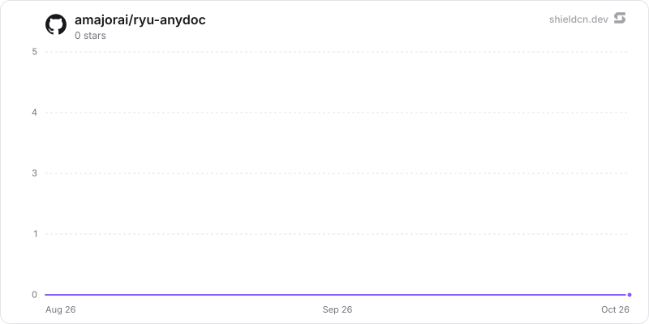

<div align="center">

# anydoc

</div>

Fast local document extraction through Firecrawl's MIT-licensed AnyDoc Rust library, with a tenant-keyed standalone /v1/extract API and the swappable document.parse provider contract.

> **The public home of `ryu-anydoc`.** Source, builds, and releases live here —
> binaries for every platform are attached to each release.
>
> This tree is generated from the Ryu monorepo, so commits pushed here
> directly are replaced on the next sync. **Pull requests are welcome** —
> open them here and they are ported into the monorepo, then flow back out.
> Ryu as a whole: https://github.com/amajorai/ryu

## Install

**App:** [Install](ryu://apps/com.ryu.anydoc) (opens the Ryu desktop app and asks you to confirm)

**CLI:**

```bash
ryu apps add com.ryu.anydoc
```

**From source:**

```bash
cargo build --release --manifest-path backend/Cargo.toml
```

Prebuilt binaries for every platform are attached to [each release](https://github.com/amajorai/ryu/releases).

## License

Apache-2.0 — see [LICENSE](./LICENSE).

## What it converts

AnyDoc emits one GitHub-Flavored Markdown result for:

- Word: `.doc`, `.docx`, `.docm`
- PowerPoint: `.ppt`, `.pps`, `.pot`, `.pptx`, `.pptm`, `.ppsx`, `.ppsm`
- Excel: `.xls`, `.xlsx`, `.xlsm`, `.xlsb`
- OpenDocument: `.odt`, `.ods`, `.odp`
- `.rtf`, `.epub`, `.csv`, and text-based `.pdf`

The format is detected from document bytes when the format has a signature. A
filename or explicit format is used for CSV and other signature-less input.
Embedded assets remain available to the upstream AnyDoc document model, while
the Markdown API returns their text/alt representation.

AnyDoc does not OCR scanned PDFs and does not make network requests in its Rust
API. Such a PDF fails with `needs_ocr`; bind a backend with OCR when scans are
part of the corpus.

## Ryu provider

The manifest registers `document.parse` with the same submit-and-poll contract
as the other parser apps:

```text
POST /api/ext/@ryu/anydoc/parse
GET  /api/ext/@ryu/anydoc/capability
GET  /api/ext/@ryu/anydoc/jobs/{job_id}
```

Core sends either a confined blob `path` plus the original filename, or inline
`contentBase64` bytes. The sidecar resolves and checks path inputs against
`RYU_ANYDOC_ROOTS` before reading them. The sidecar is loopback-only when Core
starts it. Core uses its injected `RYU_EXT_TOKEN` for managed calls; customer
API keys can submit inline bytes on the mounted route but cannot supply paths.

## Standalone service

The same binary exposes a versioned API at `/v1/extract`. Set its API keys as a
JSON object mapping tenant ids to distinct keys (one entry for a single tenant):

```sh
RYU_ANYDOC_API_TOKENS='{"acme":"acme-secret","beta":"beta-secret"}' \
RYU_ANYDOC_HOST=0.0.0.0 \
RYU_ANYDOC_PORT=8097 \
ryu-anydoc
```

Raw bytes avoid base64 overhead. `X-Filename` is required for format fallback:

```sh
curl -fsS https://extract.example.com/v1/extract \
  -H "Authorization: Bearer acme-secret" \
  -H 'Content-Type: application/pdf' \
  -H 'X-Filename: report.pdf' \
  --data-binary @report.pdf
```

JSON is useful for smaller integrations. The standalone `/v1` API accepts
inline bytes only. Filesystem `path` input requires the distinct Core-managed
provider credential, including on the mounted provider route. Customer keys can
submit inline provider jobs but cannot select files from process-wide roots.
Reusing one token as both a Core credential and a customer key does not grant
filesystem authority:

```json
{
  "contentBase64": "...",
  "filename": "report.docx"
}
```

The response includes `markdown`, the detected `format`, the AnyDoc library
version, a SHA-256 of the input, warnings, and a `truncated` flag. Errors keep a
stable `code`, including `needs_ocr`, `unsupported_format`, `encrypted_document`,
`resource_limit`, and `input_too_large`. Put TLS, edge rate limiting, and
customer billing in the deployment layer; this service owns API-key
authentication, tenant key separation, input/output bounds, and conversion.

## Configuration

| Variable | Default | Meaning |
|---|---:|---|
| `RYU_ANYDOC_HOST` | `127.0.0.1` | Bind address; use `0.0.0.0` only behind a protected edge. |
| `RYU_ANYDOC_PORT` | `8097` | Listen port. Core supplies the profile-adjusted value. |
| `RYU_EXT_TOKEN` | unset | Core-to-sidecar bearer; unset means protected routes reject all requests. |
| `RYU_ANYDOC_API_TOKENS` | unset | Tenant-to-key JSON object for standalone service mode. |
| `RYU_ANYDOC_ROOTS` | `RYU_DIR` | Absolute roots allowed for the provider's `path` form. |

The conversion limits are fixed in `backend/src/limits.rs` rather than read from
the environment: 200 MiB input, 8 MiB shared output (clipping sets
`truncated: true`), 600 s per conversion, 2 concurrent conversions, 64 retained
jobs, and request bodies of at most 64 MiB (JSON) and 256 MiB (HTTP).
`/capability` reports the input, output and time limits.

The public `/v1` route accepts only API keys. The mounted Ryu route also accepts
the Core-injected bearer, and Core's own node authentication remains in front of
it.

## Development

```sh
cargo test --manifest-path apps-store/anydoc/backend/Cargo.toml
cargo run --manifest-path apps-store/anydoc/backend/Cargo.toml
```

The backend is Apache-2.0; the upstream AnyDoc dependency is MIT-licensed.

## Star History

<a href="https://github.com/amajorai/ryu-anydoc/stargazers">
  <picture>
    <source media="(prefers-color-scheme: dark)" srcset="./.github/shieldcn/star-chart-dark.svg" />
    
  </picture>
</a>
